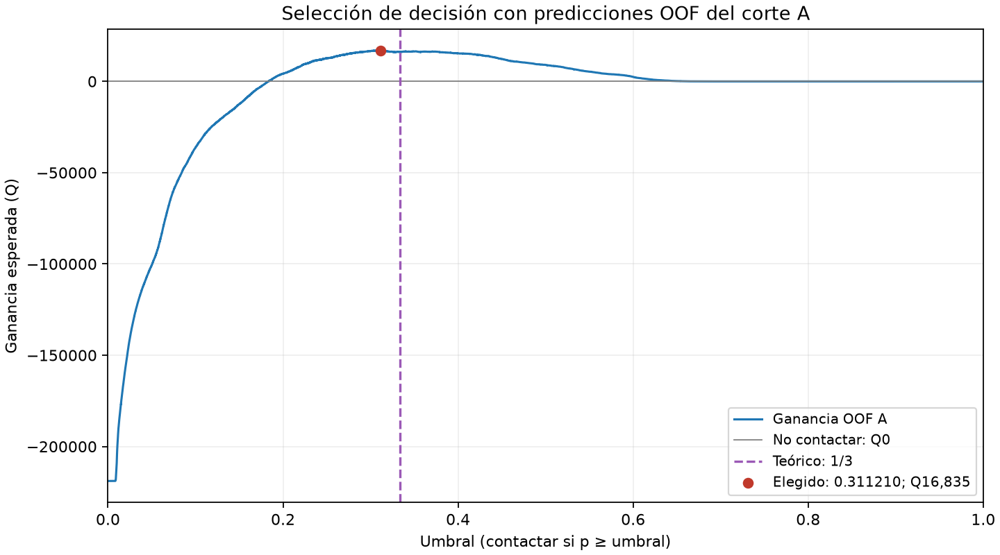
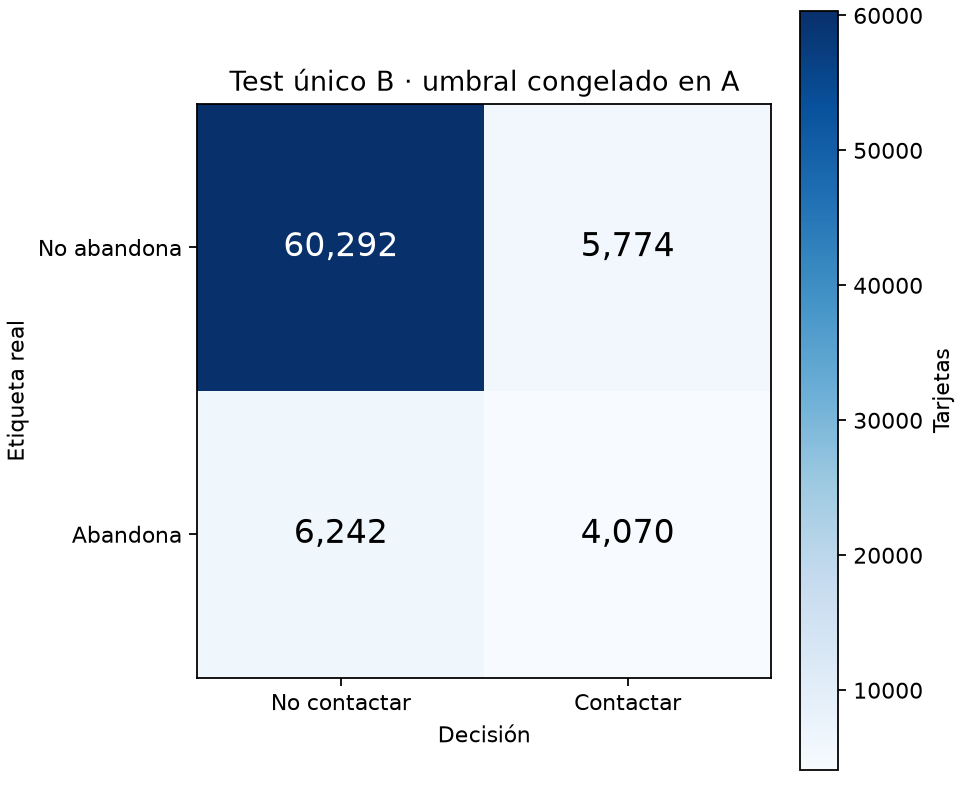

# 2.2 — Umbral según costo y test único

Modelo **rf_somero**, recomendado en 2.1. Umbral congelado: **0.311210473799652**; contactar si `p >= umbral`.

## Decisión económica

Retener un abandono contactado aporta en promedio 0.25 × Q60 = Q15. Cada contacto cuesta Q5, incluso si la tarjeta no abandonaba. Por eso:

`G = 15 TP − 5 (TP + FP) = 10 TP − 5 FP`.

Para una probabilidad real p, la ganancia esperada por contacto es `15p − 5`; es positiva cuando `p > 1/3`. En la igualdad la ganancia es cero. El umbral teórico sólo es óptimo si las probabilidades están calibradas y los supuestos económicos se cumplen.

Se eligió el máximo empírico usando exclusivamente las predicciones fuera de muestra de A: todos los scores distintos, los extremos, 1/3 y una opción explícita de no contactar. Los empates de score no se separan. Desempate: menos contactos y luego mayor umbral. No hubo calibración adicional ni elección de modelo.

Se evaluaron 72,042 umbrales. Precisión y recall sin denominador se reportan como cero. El valor `nextafter(1,+inf)` representa no contactar incluso si existen scores iguales a 1.

## Selección con OOF de A

| Política | Contactos | TP | FP | TN | FN | Precisión | Recall | Ganancia Q |
|---|---:|---:|---:|---:|---:|---:|---:|---:|
| Seleccionada | 10,625 | 4,664 | 5,961 | 60,239 | 6,547 | 0.438965 | 0.416020 | 16,835 |
| Teórica 1/3 | 8,934 | 4,056 | 4,878 | 61,322 | 7,155 | 0.453996 | 0.361788 | 16,170 |
| Nadie | 0 | 0 | 0 | 66,200 | 11,211 | 0.000000 | 0.000000 | 0 |
| Todos | 77,411 | 11,211 | 66,200 | 0 | 0 | 0.144824 | 1.000000 | -218,890 |



[Todos los umbrales y métricas](umbrales-a.csv). Esta ganancia de A es una estimación seleccionada sobre los mismos OOF: puede ser optimista y no es una nueva estimación independiente.

## Test B realizado una sola vez

Fecha exacta: `2026-11-07T16:53:50.818619-06:00`. Código: `9d84ad3fc88277fbb2ed94592fcba3dea6eb5eda`. Commit de decisión previa: `9d84ad3fc88277fbb2ed94592fcba3dea6eb5eda`.

B contiene 76,378 tarjetas: 10,312 positivas y 66,066 negativas. Contactos: 9,844. Ganancia esperada: **Q11,830**.

| Real / Decisión | No contactar | Contactar |
|---|---:|---:|
| No abandona | TN = 60,292 | FP = 5,774 |
| Abandona | FN = 6,242 | TP = 4,070 |



| Métrica | A OOF, umbral elegido | B, umbral congelado |
|---|---:|---:|
| Precisión | 0.438965 | 0.413450 |
| Recall | 0.416020 | 0.394686 |
| Ganancia Q | 16835.000000 | 11830.000000 |
| ROC-AUC agrupado | 0.816293 | 0.813388 |

En 2.1 el AUC medio de los cinco folds fue 0.816470; el AUC OOF agrupado es otro resumen. B usa un único bosque ajustado con todo A; la comparación temporal y de tamaños es descriptiva. No se reajustó nada con B.

La ganancia en B fue Q5,005 menor que la estimada en A; precisión y recall también bajaron. B tiene otra población temporal y una prevalencia de abandono de 13.50%, frente a 14.48% en A. Además, el umbral se eligió maximizando la ganancia de A, lo que puede favorecer una estimación optimista. Estos factores permiten interpretar la diferencia, pero esta única evaluación no identifica su causa. La política conserva ganancia esperada positiva en B y se mantiene exactamente la decisión congelada.

Precisión indica qué proporción de los contactos realmente abandonaba. Recall indica qué proporción de los abandonos se alcanzó. ROC-AUC mide el ordenamiento del riesgo a través de todos los umbrales; no mide calibración ni beneficio económico. TP/FP/TN/FN comparan la decisión de contactar con la etiqueta de abandono, no observan retención causal.

La ganancia es esperada bajo los supuestos Q5 / 25% / Q60, no dinero ni retenciones observadas. La unidad es tarjeta por operador, no una persona consolidada. A y B pueden compartir tarjetas: la separación es temporal, no por identidad. Se usaron las ventanas previas y disponibilidad de Silver de 1.3.

## Trazabilidad y reproducción segura

El JSON de decisión se comprometió antes de abrir B. Se verificaron hashes OOF, folds, configuración, orden de features y datos A. Se reutilizó `build_model` de 2.1: variables numéricas passthrough, operador OneHotEncoder con categorías desconocidas ignoradas; ajuste únicamente en A.

El comando `test-b` exige árbol limpio y decisión idéntica al commit previo; rechaza cambios de código, SQL, dependencias o pruebas tras seleccionar A. Una reserva exclusiva y durable se crea antes de consultar datos. La bitácora registra el acceso posible a etiquetas B antes de SQL y guarda las métricas antes de producir otros artefactos. Si falla, no reintenta automáticamente. La presencia de bitácora, resultado, modelo o predicciones impide otra ejecución.

La tabla de features se recalculó con el SQL original de 1.3 filtrando primero la población del corte. Las huellas de A y B coinciden con 1.3; la entrada de entrenamiento A coincide además con 2.1. No se reconstruyó todo el pipeline.

Ver [decisión](../../evidencias/p2-22-decision.json), [resultado único](../../evidencias/p2-22-test-b.json) y [bitácora](../../evidencias/p2-22-test-b-bitacora.jsonl). La comparación de resultados guardados y este reporte no repite predicciones ni consultas de B.

```powershell
# Pruebas con fixtures; nunca ejecutan el test real B
.venv\Scripts\python.exe -m unittest discover -s tests
# Sólo si todavía NO existe una decisión: seleccionar-a (sin SQL)
.venv\Scripts\python.exe scripts/umbral_p2_22.py seleccionar-a
# El test oficial ya está completado: NO volver a ejecutar test-b.
# reporte sólo transforma JSON guardados; rechaza sobrescribir archivos.
```

## Entrega a Jonatán para 2.4

Consumir `docs/evidencias/p2-22-decision.json`: `configuracion`, `predictores`, `umbral` y la regla inclusiva `p >= umbral`. Construir con `scripts.entrenar_p2_21_ensemble.build_model(decision["configuracion"])`; ajustar con todo A, nunca B/C. No redondear el umbral del JSON ni usar el texto redondeado de las gráficas.

El Pipeline ya ajustado en A se conserva localmente en `datos_red/p2-22-modelo-a.joblib` (ignorado), con SHA-256 en el resultado B. Puede compartirse por un medio directo; cargar sólo un artefacto de origen confiable y verificar la huella y versiones. Para reproducir el reajuste usar `load_cut_a(recalculate=True)` y `predictores` en el mismo orden. Modelo RF de 100 árboles, semilla registrada y un hilo. Python/paquetes exactos usados figuran en los JSON.

El CSV OOF y las predicciones individuales B permanecen ignorados. Para C usar features de C sin etiquetas, el Pipeline ajustado con A y la misma decisión. La interfaz de salida de 2.4 y su auditoría temporal siguen siendo responsabilidad de esa entrega; aquí no se implementan.

## Revisiones y pruebas realizadas

Las tres revisiones (matemáticas y lógica, Machine Learning, ingeniería y reproducibilidad) finalizaron antes de abrir B. Pasaron **111 pruebas, cero omitidas**, incluidas 17 de 2.2 y las integraciones PostgreSQL con fixtures TEMP. Comando: `$env:P2_TEST_POSTGRES='1'; .venv\Scripts\python.exe -m unittest discover -s tests`. Duración de la suite: 37.451 s.

Se repitió el cálculo sólo en A: la tabla de 72,042 umbrales, el máximo y la gráfica coincidieron byte a byte. La matriz de A se contrastó con un cálculo directo. Se inspeccionaron visualmente ambas gráficas. Ver [revisiones](../../evidencias/p2-22-revisiones.json) y [repetibilidad A](../../evidencias/p2-22-repetibilidad-a.json).

Después del test se verificaron únicamente los archivos guardados: sumas de TP/FP/TN/FN, fórmula económica, hashes, decisión inalterada y una sola reserva/consulta/evaluación en la bitácora. No se volvió a ejecutar el modelo ni a calcular predicciones B. El test oficial completó sin errores técnicos. El [cierre](../../evidencias/p2-22-cierre.json) conserva esas comprobaciones.
