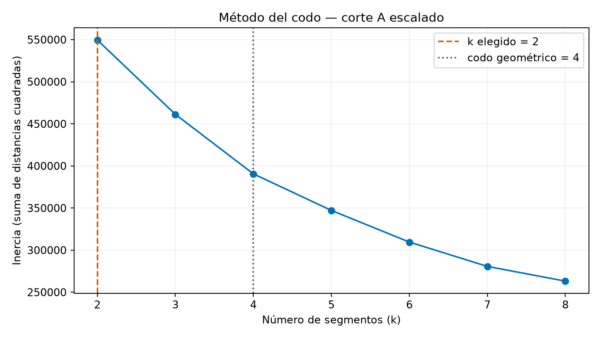
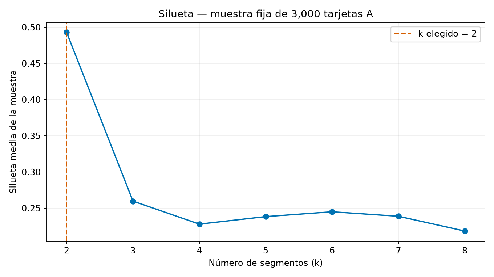
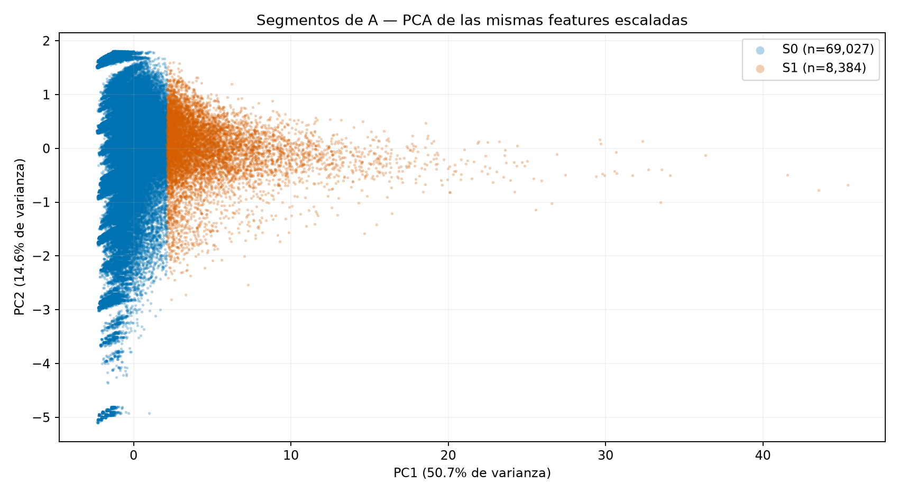

# Segmentación KMeans y PCA — corte A

Filas: 77,411. k elegido: 2; codo geométrico: 4.

Se evalúan k=2..8 sobre A escalado, con n_init=20 y semilla 2026. Se elige k=2 por máxima silueta (0.4929) en una muestra uniforme fija de 3000 filas; empates favorecen menor k. El codo geométrico está en k=4. Los criterios no coinciden: se prioriza la separación medida por silueta; el codo queda como alternativa, sin consultar etiquetas.

PCA: PC1=50.70%; PC2=14.64%; total=65.35%.

| Segmento | Nombre | Tamaño | Abandono A | Viajes 28d (mediana) | Recencia en días (mediana) | Gasto Q (mediana) |
|---|---|---:|---|---:|---:|---:|
| S0 | S0: Uso ocasional y con pausa mayor | 69027 | 11055 / 69027 = 16.0155% | 6.00 | 3.77 | 9.00 |
| S1 | S1: Uso frecuente y reciente | 8384 | 156 / 8384 = 1.8607% | 40.00 | 0.41 | 61.10 |

## Acciones propuestas

- **S0: Uso ocasional y con pausa mayor**: Recarga de retorno de monto limitado y recordatorio tras una pausa de uso.
- **S1: Uso frecuente y reciente**: Beneficio por continuidad o abono de viajes en los puntos de origen habituales.

Las tasas son descriptivas; no demuestran causalidad ni efecto de las acciones.
La etiqueta no participa en escalado, KMeans, PCA, selección de k ni nombres.
No se consultan B/C ni se incorpora el segmento al clasificador.

